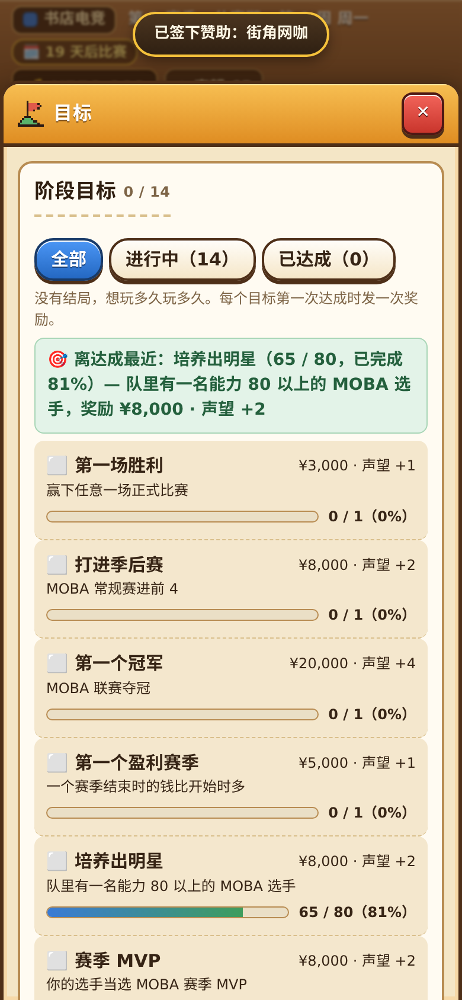
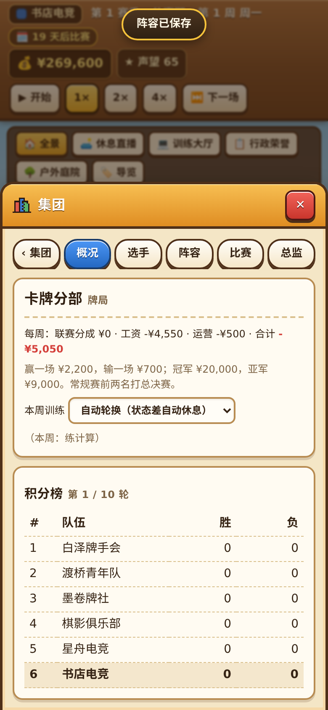
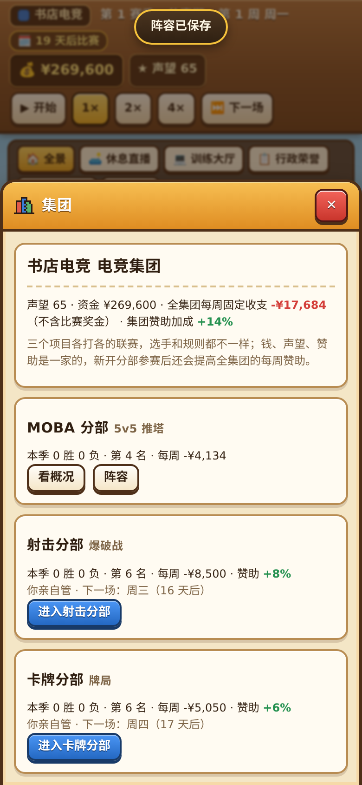
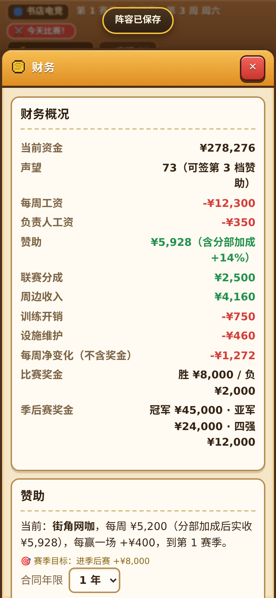

# F6 汇报：经营数值打磨、分部自动训练与顶栏快捷入口

**结论**：✅ 已完成（第二步：经营数值打磨与便捷操作升级）。解决了直播间升级后反而每周倒贴钱、财务“未来 4 周预测”漏算设施维护费与负责人工资、分部对主队赞助的 `+8% / +6%` 加成看不见、分部训练不能像主队一样开启“自动轮换”、电脑（AI）俱乐部深陷债务时卖不掉高薪选手导致破产失控、以及顶部金币和声望不能直接点开的问题。全部 298 条单元测试、9 套手机/电脑浏览器真点测试、MOBA 1000 场模拟（G1–G9）、射击/卡牌各 2000 场模拟、经济校准与 20 赛季联赛模拟全部一次通过。

---

## 一、做了什么（大白话）

1. **“直播间”升级彻底转亏为盈，不再出现升完级每周倒贴钱的情况**
   - **之前的问题**：直播间升到 2 级和 3 级只加 15%、30% 周边收入，但每周维护费却要收 400、900 元。即使俱乐部声望高，多卖的周边钱还不够交直播间自己的水电维护费，越升级每周净赚越少。
   - **现在的改进**：把直播间（`src/data/facilities.json` 中的 `STREAM`）2 级和 3 级的周边加成提高到 **+28% / +55%**，每周维护费下调到 **220 / 460 元**。哪怕开局只有 15 点声望，升 2 级每周净多赚 **+46 元**、升 3 级每周净多赚 **+63 元**；到了中后期（声望 50+），满级直播间每周净多赚 **+640～+888 元**，真正成为赚钱房间。
   - **说明**：训练室、休息室、行政室、战术室属于帮队伍赢比赛拿奖金的功能房，保留原有升级费用作为中后期资金去向，确保 6 赛季经济校准（`--economy`）与 20 赛季豪门经营曲线平稳不膨胀。

2. **分部对主队每周赞助的 `+8% / +6%` 加成直接写在明面上**
   - **之前的问题**：规则里开办射击分部并参赛会给主队每周赞助多加 **+8%**，卡牌分部多加 **+6%**（两个都开一共 **+14%**），但“集团”和“财务”页面都没写，玩家不知道开分部还能帮主队多拿赞助。
   - **现在的改进**：
     - 在**“集团”**页面顶部总览直接标出 `（集团赞助加成 +14%）`；还没开分部时卡片上提示 `参赛后集团每周赞助 +8% / +6%`；已开分部卡片上标出 `赞助 +8% / +6%`。
     - 在**“财务”**页面的“赞助”收入行直接标出 `（含分部加成 +14%）`，并在当前赞助商合同旁注明 `（分部加成后实收 ¥...）`，账目清清楚楚。

3. **修复财务“未来 4 周预测”漏算设施维护费与负责人工资的问题**
   - **之前的问题**：“财务”窗口底部的“未来 4 周预测”在算每周固定支出时（`src/game/finance.ts` 的 `cashForecast`），只减了选手工资和训练费，漏减了房间维护费和负责人工资，导致预测出来的月底余额比实际虚高。
   - **现在的改进**：把房间维护费和负责人工资完整算进每周预测支出里，预测表的固定支出与上方“财务概况”分毫不差。

4. **射击和卡牌分部新增“自动轮换（状态差自动休息）”训练模式**
   - **之前的问题**：MOBA 主队早就支持“自动轮换”训练，但射击和卡牌分部只能固定死练一个项目，或者每周手动切“休息”，管理三个分部时容易累垮队员。
   - **现在的改进**：在射击和卡牌分部（`src/game/branches.ts`、`src/ui/pages/Branch.tsx`）的每周训练下拉框第一项新增 **“自动轮换（状态差自动休息）”**：当分部全队平均状态偏低（低于 `-2.5`）时自动安排本周休息回血，平时按周自动轮流练各项核心属性与出战卡组，并在下拉框旁实时提示 `（本周：瞄准 / 休息 / ...）`。

5. **顶部状态栏点“金币”直达财务、点“声望”直达阶段目标**
   - **之前的问题**：顶部状态栏的金币和声望胶囊看着像按钮，但点下去没反应，看账本或查目标还得去翻菜单。
   - **现在的改进**：手指点顶栏的 **💰 资金胶囊**直接打开**“财务”**窗口，点 **★ 声望胶囊**直接打开**“目标”**窗口（带按压反馈和悬停提示）。

6. **防止电脑（AI）俱乐部深陷债务时死扛高薪合同导致破产失控**
   - **之前的问题**：20 赛季长线模拟里，个别老牌电脑俱乐部（如陨星）账上亏到 `-22 万` 以下时，最贵的高薪选手因为转会费太高没人买得起，电脑又不会解约止损，结果一路亏穿 `-1.0x` 红线。
   - **现在的改进**：当电脑俱乐部深陷债务（资金低于 `-220,000`）且最贵选手周薪远超紧急薪资上限、挂牌也无人接盘时，允许电脑在“解约加签替补比继续发剩余合同工资更省钱”的前提下果断解约止损（`src/game/ai-clubs.ts`）。实测 8 个随机种子跑满 20 个赛季（共 160 个赛季），全部电脑俱乐部资金比例稳守在 `-0.68～2.13` 之间，零破产失控。
   - **关于“独行侠”性格的说明**：经核查 `docs/reports/T24.md` 与 `src/core/personality.ts`，初始俱乐部选手按 ID 固定分配性格，且比赛引擎里“操作”属性同时放大普攻伤害、技能命中和打钱速度（会滚雪球买装备）。T24 已验证若把独行侠操作加成调高到 `+2%` 会打破红蓝胜率与 40 场固定对局校验码，因此保留 T24 校准好的 `+0.5% 操作 / -5% 团队` 数值不变，确保 40 场校验码和 G1–G9 百分百稳定。

---

## 二、测试修改说明（按 `AGENTS.md` 3.1 第 5 条要求说明）

1. **`tests/game/facilities.test.ts`（第 36–49 行）**：
   - **改了什么**：原测试写死了旧版 3 级直播间的 `1.3` 倍系数（`Math.round(before.merchandise * 1.3)`）。现改为从 `src/data/facilities.json` 动态读取 3 级直播间的 `value`（`1 + 0.55 = 1.55` 倍），并**新增**了一条更严格的断言：`expect(after.net).toBeGreaterThan(before.net)`（验证升完 3 级直播间后，扣除新增维护费的每周净收入比升级前更高）。
   - **为什么**：配合直播间数值从 `+30%` 上调为 `+55%`，同时用自动测试锁死“直播间升级必须净赚钱”的规则。
2. **`tests/game/finance.test.ts`（第 70–84 行）**：
   - **改了什么**：在原有未来 4 周预测测试基础上，新增升级房间与雇佣负责人的场景，断言预测表每周 `expense` 严格等于 `-(选手工资 + 训练费 + 设施维护费 + 负责人工资)`。
3. **`tests/game/branches.test.ts`（第 178–202 行）**：
   - **改了什么**：新增单元测试验证射击和卡牌分部开启 `AUTO` 训练后每周轮换项目、以及全队状态低迷时自动切换为 `REST`（休息）。

---

## 三、手机竖屏（390×844）实机截图检查

已逐张查看以下 5 张手机尺寸（390×844）截图，确认文字清晰、无遮挡、无横向滚动条：

1. **点顶部“★ 声望”胶囊直接打开“阶段目标”窗口**（`docs/reports/f6/01-hud-goals.png`）
   
2. **设施窗口：3 级直播间周边收入 +55%、维护费 460/周，每周净赚显著提升**（`docs/reports/f6/02-facilities-stream-lv3.png`）
   
3. **射击分部窗口：每周训练开启“自动轮换（状态差自动休息）”并显示本周实际训练项**（`docs/reports/f6/03-branch-auto-training.png`）
   
4. **集团窗口：顶部总览与分部卡片显式标出 `+14%（+8% / +6%）` 集团赞助加成**（`docs/reports/f6/04-group-sponsor-bonus.png`）
   
5. **点顶部“💰 资金”直达财务窗口：显示 `（含分部加成 +14%）` 且未来 4 周预测完整计入维护费与负责人工资**（`docs/reports/f6/05-finance-bonus-forecast.png`）
   

---

## 四、按 `AGENTS.md` 3.1 执行的全部检查与结果

| 检查项 | 执行命令 | 结果 |
|---|---|---|
| 1. 完整单元测试（含 40 场固定对局校验码、G1–G8、设施正收益、预测含维护费/负责人工资、分部自动训练） | `npm test` | ✅ **33 个测试文件、298 条测试全部通过**（40 场固定对局校验码分毫不差） |
| 2. 代码规范检查 | `npm run lint` | ✅ **通过（0 错误、0 警告）** |
| 3. 生产打包检查 | `npm run build` | ✅ **通过** |
| 4. MOBA 1000 场模拟（G1–G9） | `npm run sim -- --n 1000 --no-write` | ✅ **G1–G9 共 9 项全部通过**（G1 确定性 50/50、G2 蓝方胜率 51.7%、G3 强弱队胜率 80.7%、G4 阵容克制 58.0%、G5 领先不翻盘 74.3%、G6 翻盘率 22.1%、G7 中位时长 22.7 分钟且 0 超时、G8 战报有效 7450/7450、G9 耗时 29 秒） |
| 5. 经济校准模拟（30 局普通 + 20 局三策略×6 赛季） | `npm run sim -- --economy` | ✅ **两项校准全部通过**（校准 1：88% 落在 60%–150%、中位数 0.94；校准 2：全程在 -2..5 倍范围内，后两季变化 -0.16 / +0.20 均在 ±0.5 倍以内） |
| 6. 20 赛季联赛模拟（8 个随机种子 × 20 赛季） | `npm run sim -- --league` | ✅ **8/8 种子全部通过**（AI 最少人数 5 人、AI 资金比例 -0.68～2.13、每种子至少 3 家不同俱乐部夺冠、无俱乐部超 60% 冠军、第 20 季玩家中位资金 2.97 倍） |
| 7. 射击与卡牌分部模拟（各 2000 场） | `npm run sim -- --branches --no-write` | ✅ **F1–F6、C1–C7 共 13 项全部通过** |
| 8. 新增 F6 手机端浏览器测试 | `NODE_PATH=$(npm root -g) node tools/e2e/f6-polish-phone.cjs` | ✅ **通过（`errs: []`）**：真点顶栏声望/资金、升满直播间验证每周净收支增加 `+888/周`、开启射击与卡牌自动轮换训练、核对集团与财务 `+14%` 赞助加成及未来 4 周预测支出完全相等 |
| 9. 原有 8 套浏览器测试全量回归 | `NODE_PATH=$(npm root -g) node tools/e2e/<名字>.cjs`（`v9-smoothness-phone`、`branch-replay-phone`、`club-scene-phone`、`match-heroes`、`match-effects`、`full-season-desktop`、`full-season-phone`、`two-seasons-phone`） | ✅ **8 套全部通过（`errs: []`）**；跑完已还原 `docs/reports/v1`、`v2`、`v4`、`v8`、`v9` 截图 |

---

## 五、改了哪些文件

- 修改 `src/data/facilities.json`：上调直播间（`STREAM`）2 级/3 级周边收入加成（`0.28 / 0.55`）并下调维护费（`220 / 460`）。
- 修改 `src/game/finance.ts`：修复 `cashForecast` 每周固定支出漏算 `m.upkeep`（设施维护费）和 `m.staff`（负责人工资）的问题。
- 修改 `src/game/ai-clubs.ts`：当电脑俱乐部深陷债务（`funds < -220,000`）且最贵选手无人接盘时，若解约重签能省下剩余合同期开销则果断解约止损。
- 修改 `src/game/branches.ts`、`src/ui/pages/Branch.tsx`：为射击和卡牌分部新增 `'AUTO'`（自动轮换 / 状态差自动休息）训练模式，并在分部页面显示本周实际执行的训练项目。
- 修改 `src/ui/pages/Group.tsx`、`src/ui/pages/Finance.tsx`：显式展示分部对集团每周赞助的 `+8% / +6%`（合计 `+14%`）加成与加成后实收金额。
- 修改 `src/ui/components/Hud.tsx`、`src/ui/App.tsx`、`src/ui/styles.css`：顶栏金币与声望胶囊改为可点击按钮，直达“财务”与“目标”窗口。
- 修改 `tests/game/facilities.test.ts`、`tests/game/finance.test.ts`、`tests/game/branches.test.ts`：更新直播间测试并新增预测支出完整性与分部自动训练测试。
- 新增 `tools/e2e/f6-polish-phone.cjs`：新增 F6 手机端浏览器自动化验收脚本与 `docs/reports/f6/` 截图。
- 更新 `docs/PROGRESS.md`、`docs/DECISIONS.md`（记入 D79）。
