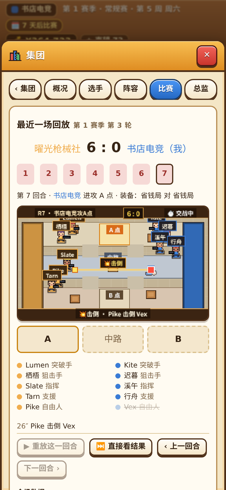
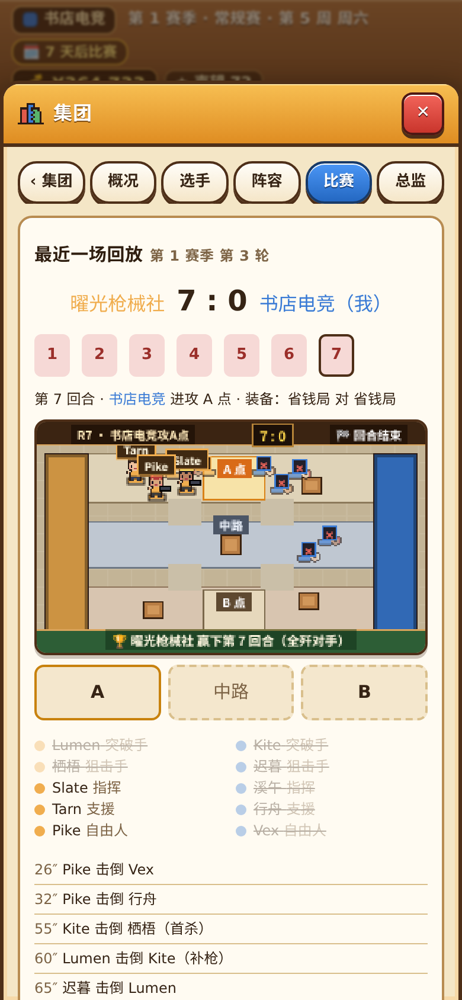
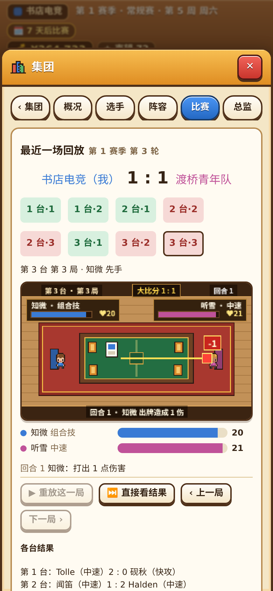
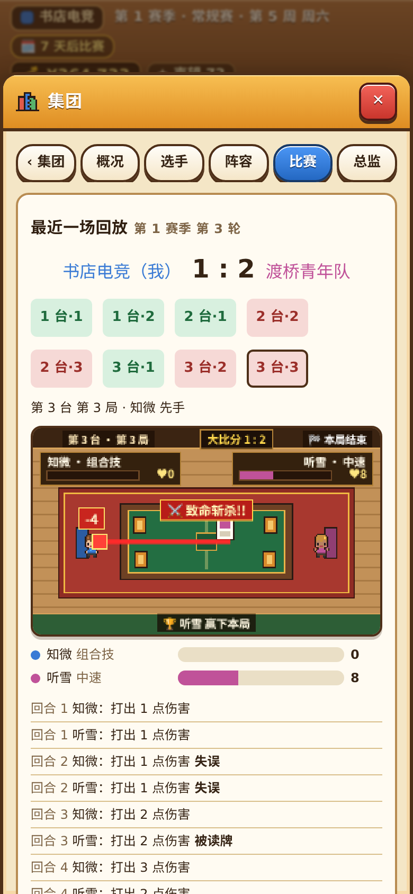

# V8 汇报：射击和卡牌分部的像素比赛画面

**结论**：✅ 已完成。现在点开“集团 → 射击分部 / 卡牌分部 → 比赛”，回放不再只是文字流水，而是有**像素小人在场上实时演完每一回合 / 每一局**。比赛引擎和数值一个字没动，画面演出来的比分、击倒、安包拆包、血量变化和最终胜负与原有数据 100% 一致。

---

## 一、做了什么

1. **射击分部像素比赛画面（260×156 像素战术赛场）**
   - 画出俯视斜角战术小地图，包含左侧蓝方出生区、右侧红方出生区、上路 **A 点**、中路走廊、下路 **B 点** 以及掩体木箱。
   - 场上 10 个原创像素小人（5v5，手持步枪或带瞄准镜的狙击枪）按回合逐步演：
     - **推进与站位**：双方从出生区向目标点位与中路展开，5 个位置各自拉开站位，不挤成一团。
     - **交火与击倒**：发生击杀时画出射击弹道光束、枪口火光、受击火花，顶部横幅弹出“⚡首杀 / ⚔️补枪 / 🗡️绕后 / 💥击倒”，倒下的选手变成倒地小人并标红叉 `✕`。
     - **佯攻、下包、拆包、爆炸**：假打转点时点位冒出烟雾弹；下包后点位出现红光脉冲闪烁的爆破装置与“💣 已下包”提示；拆包成功显示绿色解除光圈，引爆显示爆炸火光；回合结束显示获胜队名与原因（全歼 / 爆破成功 / 拆除成功 / 时间耗尽）。
2. **卡牌分部像素比赛画面（260×156 像素对决牌桌）**
   - 画出开罗风木地板赛场、红绒地毯、中央绿绒金边牌桌，两名像素选手对坐在各自战队的电竞椅上。
   - 左右上方显示双方选手名字、卡组流派标签与实时像素血条，牌桌上摆放牌库与手牌。
   - 按回合逐步出牌：
     - **出牌与攻防**：当前回合选手在桌面打出卡牌，打出伤害时一道刀光划过桌面直击对手，对手受击震动并飘出 `-伤害` 红字；回血时冒出绿光与 `+回血` 数字，双方血条随回合实时增减。
     - **六种特殊场面特效**：
       - **组合技（`COMBO`）**：桌面三张金边卡牌连成金光框，弹出“✨ 组合技爆发!!”；
       - **组合技被拦（`COMBO_STOPPED`）**：弹出“🚫 组合技被拦!”；
       - **被读牌（`READ`）**：防守方身前亮起青色护盾光墙，弹出“👁️ 读牌识破!”；
       - **出牌失误（`MISPLAY`）**：选手头顶冒出汗珠与“💦 出牌失误!”；
       - **稳住阵脚（`STABILIZE`）**：亮起绿色护盾与“🛡️ 稳住阵脚!”；
       - **致命斩杀（`LETHAL`）**：粗红光束贯穿牌桌，弹出“⚔️ 致命斩杀!!”。
3. **原有功能全部保留**
   - “▶ 重放这一回合 / 这一局”、“⏭ 直接看结果”、“‹ 上一回合 / 下一回合 ›”、顶部回合 / 对局切换按钮、A/中/B 点位条、选手存活列表、血条、文字战报流水、全场数据表与胜负关键原因全部保留且与像素画面同步。

---

## 二、手机竖屏（390×844）实机截图检查

已逐张查看以下 4 张手机尺寸（390×844）截图，确认文字清晰、按钮无遮挡、无横向滚动条：

1. **射击分部回放 · 播放中**（`docs/reports/v8/01-fps-replay-playing.png`）
   
2. **射击分部回放 · 播放结束**（`docs/reports/v8/02-fps-replay-done.png`）
   
3. **卡牌分部回放 · 播放中**（`docs/reports/v8/03-card-replay-playing.png`）
   
4. **卡牌分部回放 · 播放结束**（`docs/reports/v8/04-card-replay-done.png`）
   

---

## 三、按 `AGENTS.md` 3.1 执行的全部检查与结果

| 检查项 | 执行命令 | 结果 |
|---|---|---|
| 1. 完整单元测试（含 40 场固定对局校验码、G1–G8 样本、新增 V8 回放分镜测试） | `npm test` | ✅ **33 个测试文件、295 条测试全部通过**（用时 211.7 秒；40 场固定对局校验码分毫不差） |
| 2. 代码规范检查 | `npm run lint` | ✅ **通过（0 错误、0 警告）** |
| 3. 生产打包检查 | `npm run build` | ✅ **通过** |
| 4. 射击与卡牌分部平衡模拟（各 2000 场） | `npm run sim -- --branches` | ✅ **F1–F6、C1–C7 共 13 项全部通过**（用时 5 秒，证明未改动任何比赛逻辑与数值） |
| 5. 新增分部回放手机浏览器测试 | `NODE_PATH=$(npm root -g) node tools/e2e/branch-replay-phone.cjs` | ✅ **通过（`errs: []`）**：在 390×844 手机屏下开办射击和卡牌分部、打完 3 轮、点开两个分部回放、真点“▶ 重放”和“⏭ 直接看结果”，校验画面比分与生命值与存档回放数据 100% 一致，无报错、无横向溢出 |
| 6. 原有 6 套浏览器测试全量回归 | `NODE_PATH=$(npm root -g) node tools/e2e/<名字>.cjs`（`club-scene-phone`、`full-season-desktop`、`full-season-phone`、`match-effects`、`match-heroes`、`two-seasons-phone`） | ✅ **6 套全部通过（`errs: []`）**；跑完已用 `git checkout -- docs/reports/v1 docs/reports/v2 docs/reports/v4` 还原被覆盖的旧截图 |
| 7. MOBA 1000 场模拟（`npm run sim -- --n 1000`） | 没跑（本任务只加分部回放画面，未触碰 `src/sim`、`src/game`、`src/data`） | —（已在完整 `npm test` 中跑过 40 场固定对局校验码与 G1–G8 模拟测试，全部通过） |

**测试脚本微小修正说明（按 `AGENTS.md` 3.1 第 5 条如实说明）**：
- `tools/e2e/full-season-phone.cjs` 第 6 行原本写死了旧机器绝对路径 `const SHOTS = '/home/user/esports-empire-kit/docs/reports/v1'`，导致在非 `/home/user` 目录下截图报路径不存在。已改成与其他 5 个脚本一致的相对路径 `const SHOTS = 'docs/reports/v1'`，未删减或放松任何测试断言。

---

## 四、修改与新增的文件

- 新增 `src/render/branch/choreo.ts`：纯函数计算射击每一步的小人坐标、朝向、存活、弹道、装置状态，以及卡牌每一回合的血量、出牌、伤害/回血与特殊词条横幅（不引用 DOM，可在 Node 中直接测试）。
- 新增 `src/render/branch/BranchPainter.ts`：用代码几何像素与项目原有的 `chibi` 像素小人绘制射击战术地图与卡牌对决牌桌。
- 修改 `src/ui/components/BranchReplay.tsx`：在射击和卡牌回放中接入像素画布，保留全部原有按钮、回合切换、文字流水和数据表。
- 修改 `src/ui/styles.css`：新增 `.branch-replay-canvas` 像素画布自适应样式。
- 新增 `tests/render/branch-replay.test.ts`：验证射击与卡牌回放每一步的状态与原始回放数据严格一致。
- 新增 `tools/e2e/branch-replay-phone.cjs`：手机尺寸（390×844）下开分部、打比赛、点“重放”和“直接看结果”并核对比分的浏览器测试。
- 修改 `tools/e2e/full-season-phone.cjs`：截图目录改为相对路径 `'docs/reports/v1'`。
- 更新 `docs/PROGRESS.md`、`docs/DECISIONS.md`（D77）。
