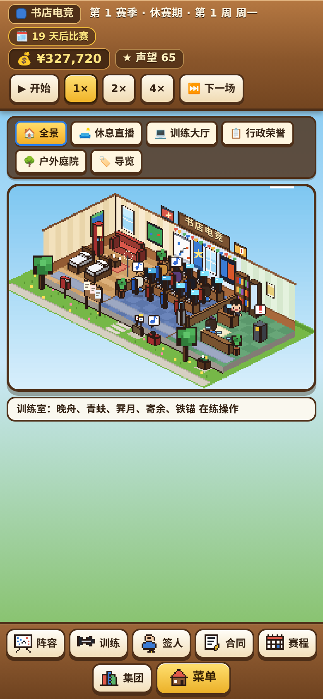
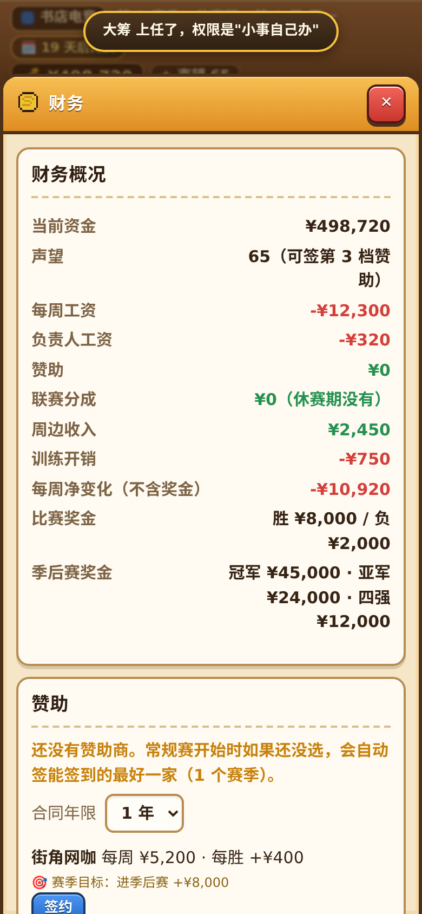
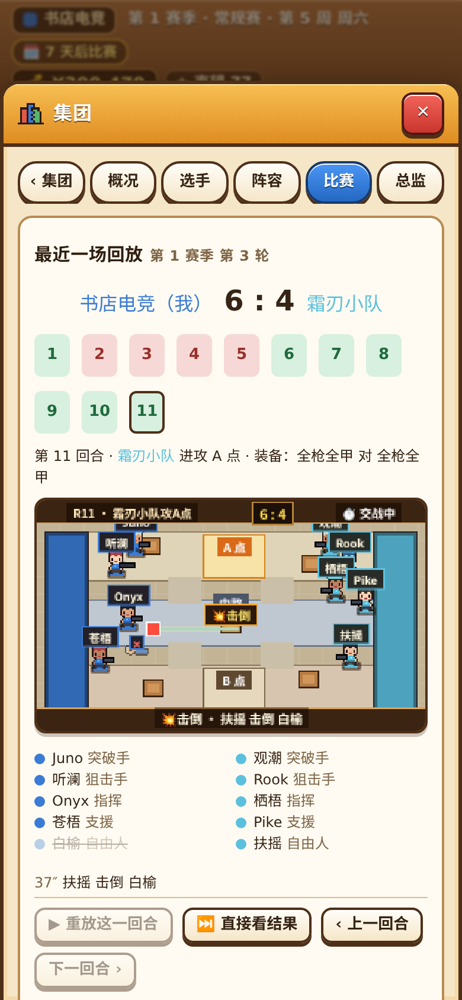
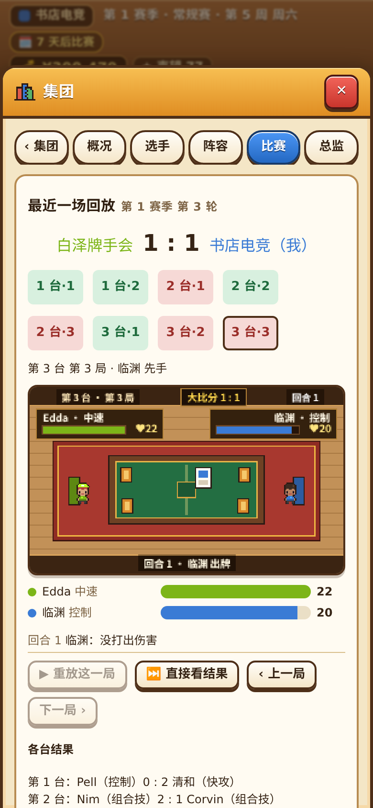

# V9 汇报：全场景画面流畅度升级、基地分部庭院摆件与界面漏项修复

**结论**：✅ 已完成（第一步：纯画面流畅度与界面修复，未改动任何比赛计算与经营数值）。主界面基地解除 30 帧锁帧、支持高刷丝滑运行，开设射击/卡牌分部后基地前院会摆出可点击的分部专属设施；MOBA 比赛 4 倍速看球不再掉帧卡顿；射击和卡牌回放升级为连续 60 帧丝滑动画并去掉了重复占屏的文字格子；财务页补上了漏掉的“负责人工资”和明细，账面每一行加起来严丝合缝。

---

## 一、做了什么（大白话）

1. **主界面基地解除 30 帧封顶，升级为原生高帧率（60帧 / 120帧）**
   - 之前基地画面（`src/render/club/ClubScene.ts`）写死了每秒最多画 30 次，在手机高刷屏上小人走路和拖拽回看会有顿挫感。现在去掉了 30 帧限制，直接跟随屏幕刷新率丝滑运行；同时把 45 件家具的遮挡排序改成只在建楼或升设施时排一次，平时每帧耗时仅约 **0.3 毫秒**（4 倍降速模拟低端手机 CPU 下依然稳跑 **60.5 帧/秒**）。
2. **开设射击 / 卡牌分部后，基地前院新增专属互动摆件**
   - 之前开办分部后只在屋顶招牌旁挂两块小牌子，基地院子里看不出集团壮大的变化。现在：
     - 开办**射击分部**后：屋顶挂红底准星铭牌，前院步道右侧草坪新摆出**战术打靶台**（双色靶牌 + 跳动瞄准灯）；
     - 开办**卡牌分部**后：屋顶挂金底卡牌铭牌，前院右侧草坪新摆出**露天牌桌**（绿绒桌面 + 悬浮双牌动画）；
     - 手指直接点前院的打靶台或露天牌桌，都会直接打开**“集团”**窗口。
3. **MOBA 5v5 比赛画面流畅度升级（特别是 4 倍速团战）**
   - 之前看比赛开 4 倍速时，网页每秒要重排约 40 次右侧数据栏和文字播报，还会每帧重复查询上百次贴图缓存和单位数组，容易发热掉帧。现在把右侧界面刷新合并为每秒 10 次（比赛结束瞬间立即刷新，不延迟），贴图和单位查询全部改为缓存直取，镜头缩放背景改为整像素对齐，画面丝滑且结果与“跳过”分毫不差。
4. **射击和卡牌分部回放升级为 60 帧连续动画，去掉重复文字框**
   - 之前两个分部的像素回放每隔近 1 秒才跳一下位置，像翻幻灯片。现在补上了步与步之间的连续插值动画：射击小人会沿路线平滑推进、子弹带飞行曳光；卡牌从选手席平滑飞上牌桌、刀光划过桌面、血条顺滑扣减。
   - 同时去掉了射击画布正下方重复的 `A | 中路 | B` 三个大文字框，手机竖屏不用往下翻就能一次看全像素赛场、10 名选手存活状态和重放按钮。
5. **修复“财务”窗口漏掉“负责人工资”和工资明细的问题 + 补齐网页小图标**
   - 之前聘请经理、教练、财务负责人后，总账扣了他们的工资，但“财务概况”和“工资明细”里没写这一行，玩家把页面上的数字加起来会对不上“每周净变化”。现在已补上**“负责人工资”**和负责人名单明细，页面每一行收支加起来与“每周净变化（不含奖金）”分毫不差。
   - 顺手给网页 `index.html` 补上了原创像素金奖杯图标，消除浏览器每次打开页面找不到 `favicon.ico` 的报错。

---

## 二、手机竖屏（390×844）实机截图检查

已逐张查看以下 5 张手机尺寸（390×844）截图，确认文字清晰、无遮挡、无横向滚动条：

1. **基地全景（已开射击 + 卡牌分部，屋顶铭牌 + 前院打靶台与露天牌桌）**（`docs/reports/v9/01-base-divisions.png`）
   
2. **基地“户外庭院”特写（前院打靶台与露天牌桌放大，真点均可打开集团窗口）**（`docs/reports/v9/05-yard-divisions-zoom.png`）
   
3. **财务窗口（补齐“负责人工资”后，各项收支加总与每周净变化完全一致）**（`docs/reports/v9/02-finance-staff-wage.png`）
   
4. **射击分部回放（去掉冗余三格文字框，一屏看全赛场、10 人状态与曳光弹交火）**（`docs/reports/v9/03-fps-replay-clean.png`）
   
5. **卡牌分部回放（卡牌平滑飞入桌面与血条顺滑变化）**（`docs/reports/v9/04-card-replay-smooth.png`）
   

---

## 三、按 `AGENTS.md` 3.1 执行的全部检查与结果

| 检查项 | 执行命令 | 结果 |
|---|---|---|
| 1. 完整单元测试（含 40 场固定对局校验码、G1–G8、新增单位缓存与回放平滑插值测试） | `npm test` | ✅ **33 个测试文件、297 条测试全部通过**（未改动任何模拟与数值，40 场校验码完全一致） |
| 2. 代码规范检查 | `npm run lint` | ✅ **通过（0 错误、0 警告）** |
| 3. 生产打包检查 | `npm run build` | ✅ **通过** |
| 4. 射击与卡牌分部平衡模拟（各 2000 场） | `npm run sim -- --branches` | ✅ **F1–F6、C1–C7 共 13 项全部通过**（用时 4 秒） |
| 5. 新增 V9 手机端浏览器测试 | `NODE_PATH=$(npm root -g) node tools/e2e/v9-smoothness-phone.cjs` | ✅ **通过（`errs: []`）**：实测基地 61 帧/秒（单帧 0.31ms）、真点前院两个分部摆件均打开“集团”、聘请负责人后财务各项收支加总等于每周净变化、4 倍速看球无报错、射击与卡牌回放重放/跳过正常且无横向滚动 |
| 6. 原有 7 套浏览器测试全量回归 | `NODE_PATH=$(npm root -g) node tools/e2e/<名字>.cjs`（`branch-replay-phone`、`club-scene-phone`、`match-heroes`、`match-effects`、`full-season-desktop`、`full-season-phone`、`two-seasons-phone`） | ✅ **7 套全部通过（`errs: []`）**（其中 `club-scene-phone` 在 4 倍降速 CPU 下实测达 60.5 帧/秒）；跑完已还原 `docs/reports/v1`、`v2`、`v4`、`v8` 旧截图 |
| 7. MOBA 1000 场模拟（`npm run sim -- --n 1000`） | 没跑（本步只改画面渲染与界面显示，未触碰 `src/sim`、`src/game`、`src/data`） | —（下一步调数值时会完整跑 `npm run sim -- --n 1000`、`--economy`、`--league`、`--group`） |

---

## 四、改了哪些文件

- 修改 `src/render/club/ClubScene.ts`：解除 30 帧锁帧、预排家具深度消除每帧重复分配，新增前院射击打靶台与卡牌露天牌桌及屋顶图标细节。
- 修改 `src/render/player.ts`：新增 `unitById` 快照单位索引缓存，消除每帧重复遍历数组。
- 修改 `src/render/MatchScene.ts`：缓存已生成贴图键、复用 `unitById`、镜头背景改为整像素对齐。
- 修改 `src/ui/pages/Match.tsx`：比赛界面右侧数据栏与播报按 100ms 合并刷新（完场即刻刷新）。
- 修改 `src/render/branch/choreo.ts`、`src/render/branch/BranchPainter.ts`、`src/ui/components/BranchReplay.tsx`、`src/ui/styles.css`：射击与卡牌回放支持连续 60 帧步内插值动画（走位、曳光弹、出牌飞行、血条顺滑扣减），移除重复的 `.fps-map` 文字框。
- 修改 `src/ui/pages/Finance.tsx`：补齐“负责人工资”行与“工资明细”中的在职负责人条目。
- 修改 `index.html`：新增内联像素金奖杯图标，消除浏览器 `/favicon.ico` 404 报错。
- 修改 `tests/render/player.test.ts`、`tests/render/branch-replay.test.ts`：新增 2 条单元测试（未删减或放松任何原有测试）。
- 新增 `tools/e2e/v9-smoothness-phone.cjs`：新增 V9 手机端浏览器自动化验收脚本。
- 更新 `docs/PROGRESS.md`、`docs/DECISIONS.md`（记入 D78）。
- 有没有动范围外的文件：**没有**（`src/sim*`、`src/game/*`、`src/data/*` 零改动）。

---

## 五、做了哪些决定 & 下一步

- **已记入 `DECISIONS.md`（D78）**：全场景渲染帧率与缓存优化方案、分部前院互动摆件位置、射击回放精简重复点位框、财务页补齐负责人工资展示。
- **需要你拍板的**：无。代码已直接推送到你的 GitHub `master` 分支（未部署任何公开页面），你可以随时拉取预览。
- **下一步（等你回复“继续”后开工）**：按既定方案进入**第二步（F6：经营数值打磨与便捷操作升级）**——上调偏亏的直播间与设施回本收益、外显分部对主队赞助的 `+8% / +6%` 加成、修复未来几周现金预测漏算维护费与负责人工资、给电脑豪门设合理薪资上限防滚雪球垄断、加强偏弱的“独狼”性格、给分部加“自动轮换训练”、以及顶栏点金币跳财务 / 点声望跳阶段目标。
